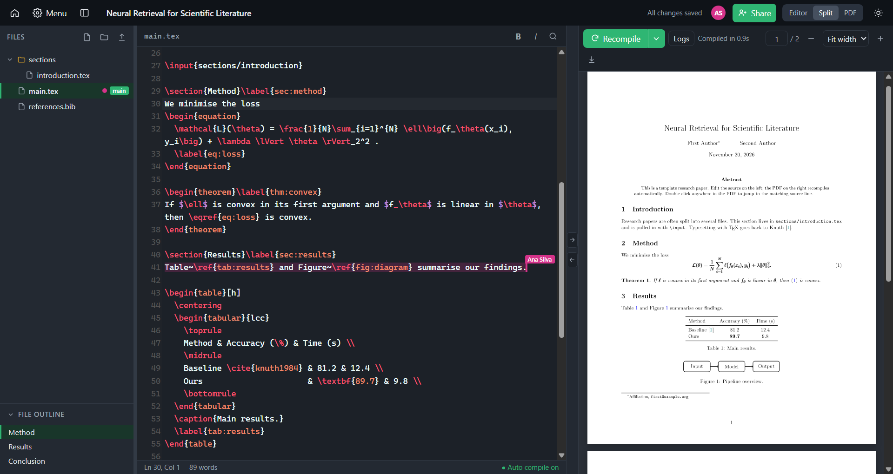
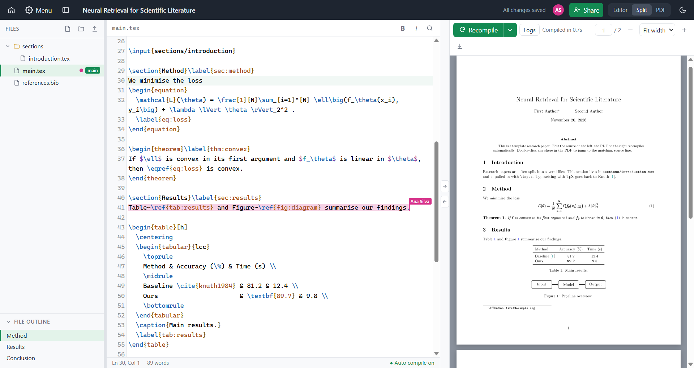
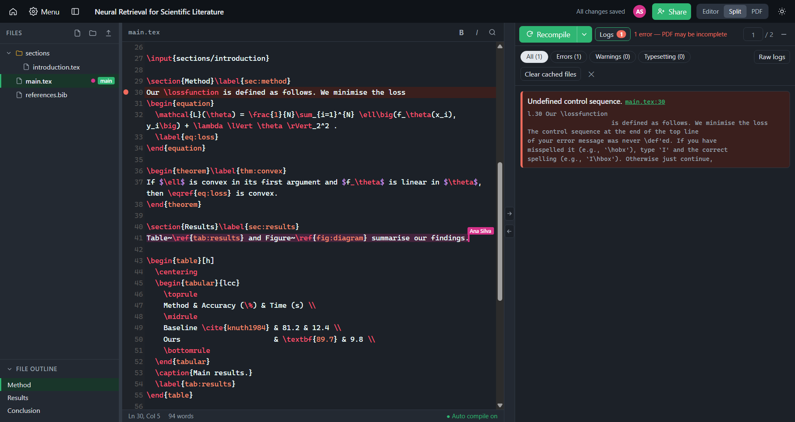
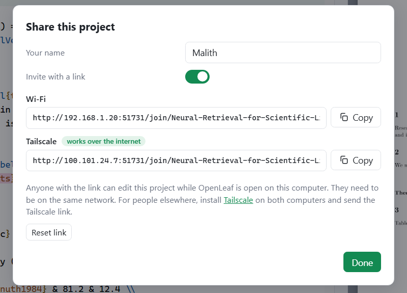
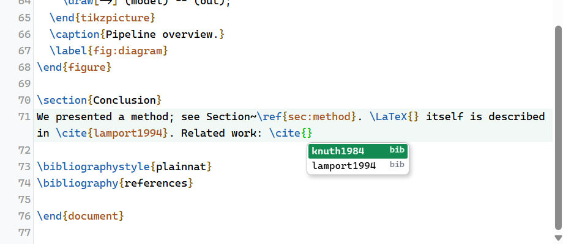
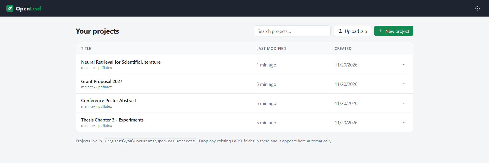
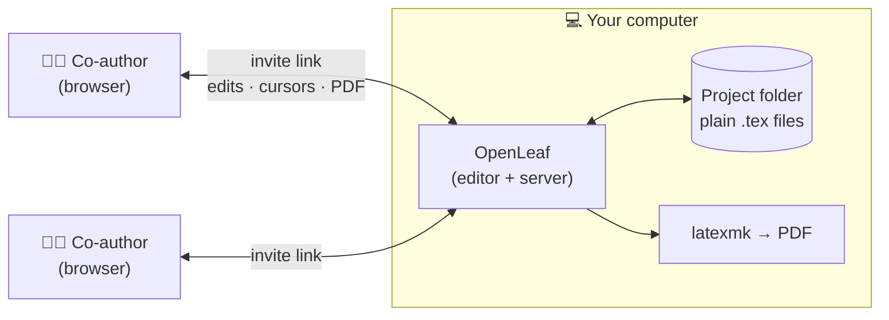
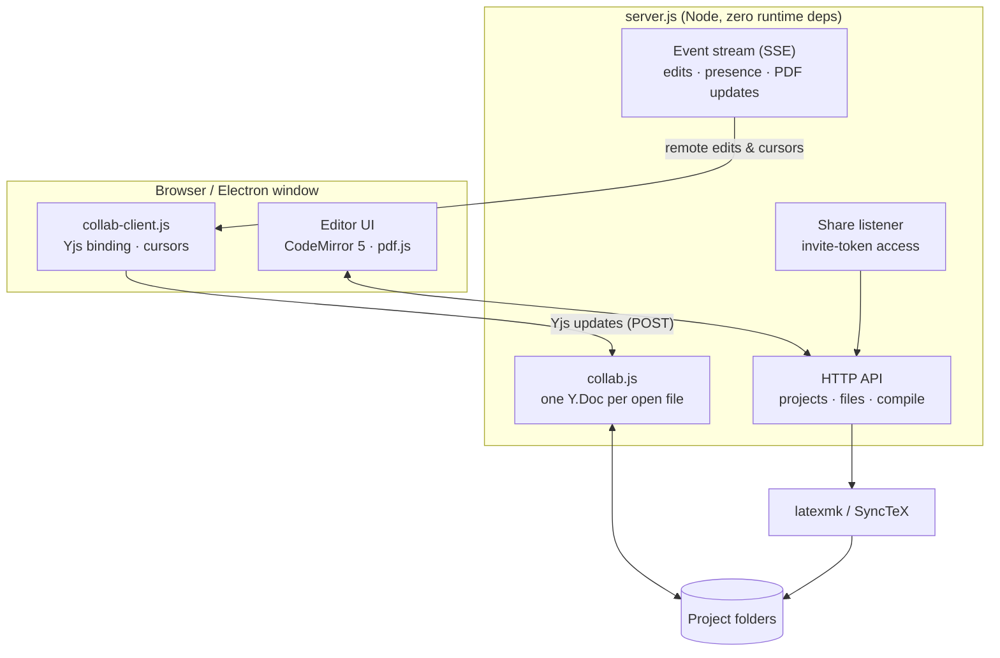

<div align="center">


# OpenLeaf

**The Overleaf experience, on your own computer.**

Write LaTeX with a live PDF preview and co-author in real time. No cloud, no accounts, no compile timeouts.

[](https://github.com/Maith-Dulsara/OpenLeaf/releases)
[](https://github.com/Maith-Dulsara/OpenLeaf/actions/workflows/ci.yml)
[](LICENSE)
[](#-quick-start)
[](CONTRIBUTING.md)
[](https://github.com/Maith-Dulsara/OpenLeaf/stargazers)

[**Download**](https://github.com/Maith-Dulsara/OpenLeaf/releases/latest) ·
[**Quick start**](#-quick-start) ·
[**Features**](#-features) ·
[**Collaborate**](#-real-time-collaboration) ·
[**Contributing**](#-contributing)

<br>



<sub>Editing a paper while co-author <i>Ana Silva</i> selects a sentence. Her named cursor, her avatar and the live PDF all update in real time.</sub>

</div>

---

## 📌 Why OpenLeaf?

Overleaf made LaTeX collaborative, but it lives in someone else's cloud: compile timeouts on the free plan, a
collaborator limit, and your thesis on a server you don't control. Desktop TeX editors keep your files local but
lose the things that make Overleaf pleasant.

**OpenLeaf gives you both.** It's a desktop app (or a tiny local web server) that looks and works like Overleaf, compiles with
**your own TeX installation**, and lets co-authors join from their browser with a link.

- 🔒 **Your files stay yours.** Every project is a plain folder of `.tex` files. Use git, Dropbox or VS Code alongside it.
- ⚡ **No compile limits.** Big theses, TikZ-heavy papers and long bibliographies compile as fast as your machine allows.
- 👥 **Real-time co-authoring without a cloud.** Share a link and edit together, character by character, with live cursors.
- ✈️ **Works offline.** On a plane, in a lab, behind a firewall.
- 💸 **Free and open source** under the MIT license.

## ✨ Features

<table>
<tr>
<td width="50%" valign="top">

### ✍️ Editing
- LaTeX syntax highlighting, bracket matching and auto-close
- **Autocomplete** for commands and environments (`\begin{…}` adds its `\end`), plus `\ref`/`\cite` keys
  from your labels and `.bib` files
- Find & replace, go to line, comment toggle
- Spell check that skips LaTeX commands
- File outline, word count, dark mode

</td>
<td width="50%" valign="top">

### 📄 Compiling & preview
- **Auto-compile** as you type with `latexmk`
- pdfLaTeX, XeLaTeX or LuaLaTeX; BibTeX/Biber run automatically
- Fast PDF preview that **keeps your scroll position**
- **SyncTeX:** double-click the PDF to jump to the source, and back
- Clear **error & warning list**, click to jump to the line, markers in the editor

</td>
</tr>
<tr>
<td width="50%" valign="top">

### 👥 Collaboration
- **Invite by link.** Guests need only a browser
- Conflict-free merging with [Yjs](https://yjs.dev) CRDTs
- **Live cursors & selections** with names and colours
- Who's online, and who's in which file
- **Undo only your own edits**
- Edits from VS Code or any other editor are merged in live

</td>
<td width="50%" valign="top">

### 🗂️ Projects
- Dashboard: create, rename, copy, search
- Import/export `.zip`; research-paper template
- File tree with drag-and-drop upload & move
- Deleted files go to a recoverable trash
- Desktop app with installer *or* browser mode
- Detects MiKTeX / TeX Live automatically

</td>
</tr>
</table>

## 📸 Screenshots

<table>
<tr>
<td width="50%"><p align="center"><sub>Light theme, split view with live PDF</sub></p></td>
<td width="50%"><p align="center"><sub>Errors explained, with a click to jump to the line</sub></p></td>
</tr>
<tr>
<td width="50%"><p align="center"><sub>Invite co-authors with a link</sub></p></td>
<td width="50%"><p align="center"><sub>Autocomplete for citations, labels and commands</sub></p></td>
</tr>
<tr>
<td colspan="2"><p align="center"><sub>All your projects in one place</sub></p></td>
</tr>
</table>

## 🚀 Quick start

### 1. Install LaTeX (if you haven't)

OpenLeaf uses the TeX distribution already on your computer:

| OS | Install |
|---|---|
| Windows | [MiKTeX](https://miktex.org/download). In MiKTeX Console set *Install missing packages* to **Always**. Also install [Strawberry Perl](https://strawberryperl.com/), which `latexmk` needs. |
| macOS | [MacTeX](https://tug.org/mactex/) |
| Linux | `sudo apt install texlive-full latexmk` (or your distro's TeX Live) |

### 2. Get OpenLeaf

**🪟 Windows desktop app (recommended):** download from [**Releases**](https://github.com/Maith-Dulsara/OpenLeaf/releases/latest):

| File | What it is |
|---|---|
| `OpenLeaf-Setup-x.y.z.exe` | Installer: per-user, no admin rights, Start-menu & desktop shortcuts |
| `OpenLeaf-Portable-x.y.z.exe` | Single file you can run from anywhere, even a USB stick |

> The installer isn't code-signed yet, so Windows SmartScreen may warn you on first run. Click **More info → Run anyway**.

**🌐 Browser mode (any OS with Node.js 20+):**

```bash
git clone https://github.com/Maith-Dulsara/OpenLeaf.git
cd OpenLeaf
node server.js --open
```

There's no `npm install` step; everything the browser needs is bundled. On Windows you can also double-click `start.bat`.

**🛠️ Build the desktop app yourself:**

```bash
npm install
npm run app          # run the desktop app from source
npm run dist         # build the Windows installer + portable exe into dist/
npm run dist:mac     # or dist:linux, run on that OS (community testing welcome!)
```

### 3. Write

Click **New project → Research paper**, start typing, and watch the PDF update. Your projects live in
`Documents\OpenLeaf Projects` (desktop) or `projects/` (browser mode). To open an existing paper, drop its folder in there.

## 👥 Real-time collaboration

1. Open a project and click **Share**.
2. Turn on **Invite with a link** and send it to your co-authors.
3. They open it in any browser, pick a name, and start editing. Nothing to install.



| | |
|---|---|
| **Same network** | The link works for anyone on your Wi-Fi or office network. Windows asks once whether OpenLeaf may accept connections; allow it for *private* networks. |
| **Over the internet** | Install free [Tailscale](https://tailscale.com/download) on both computers. The Share dialog then shows a link that works from anywhere, encrypted end to end. |
| **Access control** | Each link opens **one** project. Guests can't see your other projects, delete anything, or open your folders. **Reset link** revokes access instantly. |
| **Where edits go** | Straight into your project folder as normal files, so they keep working with git and other editors. |
| **Availability** | Your computer is the server, so co-authors can edit while OpenLeaf is open on it. |

Under the hood every open file is a [Yjs](https://yjs.dev) document. Simultaneous edits merge without conflicts,
and the merged text is written back to disk. Read [SECURITY.md](SECURITY.md) for the full access model.

## ⚖️ OpenLeaf vs. Overleaf

| | **OpenLeaf** | Overleaf (free) |
|---|:---:|:---:|
| Where your files live | Your disk | Overleaf's servers |
| Compile time limit | None | Limited |
| Works offline | ✅ | ❌ |
| Real-time collaboration | ✅ (link sharing) | ✅ (1 collaborator on free plan) |
| Use any TeX packages/fonts installed locally | ✅ | Their TeX Live image |
| Edit with VS Code / git at the same time | ✅ | Git sync is a paid feature |
| Track changes, comments, history | 🛣️ [Roadmap](#%EF%B8%8F-roadmap) | ✅ (some paid) |
| Price | Free, MIT | Free tier + paid plans |

<sub>Comparison reflects Overleaf's public plans at the time of writing and may change.</sub>

## 🏗️ Architecture



<details>
<summary><b>📁 Repository layout</b></summary>

```
server.js            HTTP API, compile pipeline, log parser, SyncTeX, sharing & access control
collab.js            Real-time collaboration engine (Yjs), persists to disk
electron/main.js     Desktop app shell
public/              Dashboard + editor (plain HTML/CSS/JS, no build step)
public/vendor/       Bundled CodeMirror 5, pdf.js and Yjs
lib/yjs.cjs          Yjs bundle for the server
scripts/vendor.js    Rebuilds public/vendor and lib from node_modules
test/                node:test suites
```

</details>

<details>
<summary><b>⌨️ Keyboard shortcuts</b></summary>

| Keys | Action |
|---|---|
| <kbd>Ctrl</kbd>+<kbd>S</kbd> | Save & recompile |
| <kbd>Ctrl</kbd>+<kbd>Enter</kbd> | Recompile |
| <kbd>Ctrl</kbd>+<kbd>Space</kbd> | Autocomplete |
| <kbd>Ctrl</kbd>+<kbd>/</kbd> | Toggle comment |
| <kbd>Ctrl</kbd>+<kbd>B</kbd> / <kbd>Ctrl</kbd>+<kbd>I</kbd> | Bold / italic |
| <kbd>Ctrl</kbd>+<kbd>F</kbd> / <kbd>Ctrl</kbd>+<kbd>H</kbd> | Find / replace |
| <kbd>Ctrl</kbd>+<kbd>G</kbd> | Go to line |
| <kbd>Ctrl</kbd>+<kbd>Z</kbd> | Undo (your own edits only) |
| <kbd>Ctrl</kbd>+<kbd>Alt</kbd>+<kbd>→</kbd> | Jump from code to PDF |
| Double-click PDF | Jump from PDF to code |
| <kbd>Ctrl</kbd>+mouse wheel | Zoom PDF |

</details>

<details>
<summary><b>⚙️ Configuration (browser mode)</b></summary>

| Environment variable | Default | Meaning |
|---|---|---|
| `PORT` | `5050` | Port for your own (local-only) access |
| `OPENLEAF_PROJECTS` | `./projects` | Projects folder (or pass it as an argument: `node server.js "D:\Papers"`) |
| `OPENLEAF_TIMEOUT` | `300` | Compile timeout in seconds |
| `OPENLEAF_SHARE_PORT` | port + 1 | Port collaborators connect to when sharing is on |
| `OPENLEAF_SHARE_HOST` | `0.0.0.0` | Interface the share listener binds to |

The desktop app stores its settings per user and lets you change the projects folder from *File → Change projects folder…*.

</details>

## 🛣️ Roadmap

- [x] Overleaf-style editor with live PDF preview and SyncTeX
- [x] Windows desktop app (installer + portable)
- [x] Real-time collaboration with invite links, live cursors and presence
- [ ] Comment threads on selected text
- [ ] Track changes / suggestion mode
- [ ] Project history with snapshots and diff
- [ ] Signed macOS and Linux builds in CI
- [ ] HTTPS for invite links on local networks
- [ ] Template gallery (IEEE, ACM, Springer, thesis…)
- [ ] Zotero / BibTeX library integration
- [ ] Vim and Emacs keybindings

Have an idea? [Open a feature request](https://github.com/Maith-Dulsara/OpenLeaf/issues/new/choose). 👋

## 🤝 Contributing

Contributions of all sizes are welcome: bug reports, docs, translations, features. Start with
[CONTRIBUTING.md](CONTRIBUTING.md) for setup and project structure.

```bash
npm install
npm start      # browser mode with your changes
npm test       # collaboration, access control and log-parser tests
```

<a href="https://github.com/Maith-Dulsara/OpenLeaf/graphs/contributors">
  
</a>

## ⭐ Star history

If OpenLeaf saves you from a compile timeout the night before a deadline, consider giving it a star. It helps others find the project.

<a href="https://star-history.com/#Maith-Dulsara/OpenLeaf&Date">
  <picture>
    <source media="(prefers-color-scheme: dark)" srcset="https://api.star-history.com/svg?repos=Maith-Dulsara/OpenLeaf&type=Date&theme=dark">
    
  </picture>
</a>

## 🙏 Acknowledgements

OpenLeaf stands on the shoulders of great open-source projects:
[CodeMirror](https://codemirror.net/5/) (editor) ·
[pdf.js](https://mozilla.github.io/pdf.js/) (PDF rendering) ·
[Yjs](https://yjs.dev) (CRDT collaboration) ·
[latexmk](https://ctan.org/pkg/latexmk) & [SyncTeX](https://github.com/jlaurens/synctex) (compiling and source ↔ PDF sync) ·
[Electron](https://www.electronjs.org/) (desktop app).

Inspired by [Overleaf](https://www.overleaf.com). OpenLeaf is an independent project and is not affiliated with or endorsed by Overleaf.

## 📄 License

[MIT](LICENSE) © 2026 Malith Dulsara

<div align="center"><sub>Made with 🍃 for everyone who writes in LaTeX.</sub></div>
